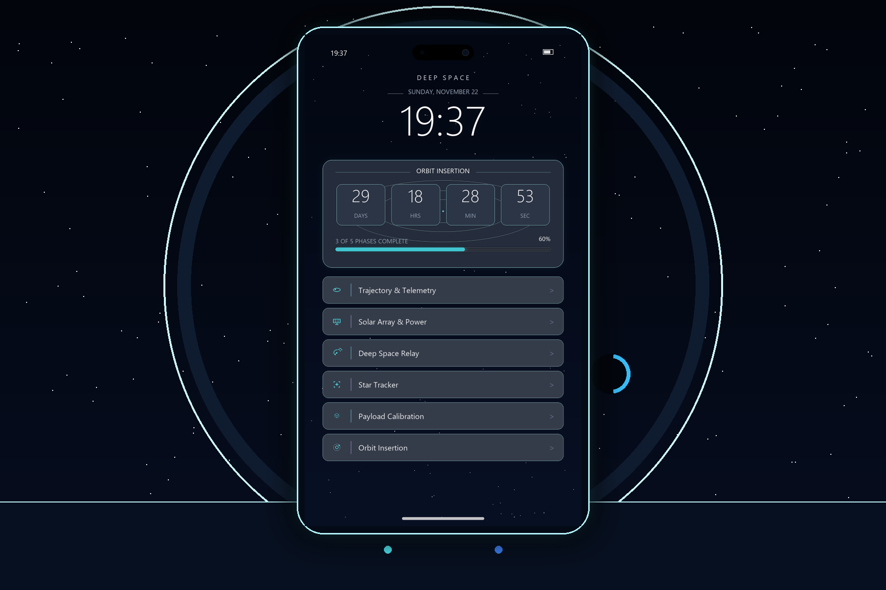

# 🛰️ ChronoCraft — Deep Space Orbit Insertion Mission Control

> **A countdown lock screen & mission dashboard for the Google × Handshake "Your Deadline, Your Design" challenge.**



---

## 🚀 Live Demo

Open `index.html` in any modern browser, or serve locally:

```bash
python -m http.server 8080
# → http://localhost:8080
```

---

## 📁 Project Structure

```
countdown/
├── index.html                    # Main app — phone mockup + controls
├── style.css                     # Design system (Deep Space HUD tokens)
├── app.js                        # Live clock, countdown, SVG icons, export
├── generate_cosmic_lockscreen.py # Pillow script → 1080×1920 wallpaper PNG
├── wallpaper_cosmic_lockscreen.png  # Generated mobile lock screen wallpaper
├── cover_cosmic_3x2.png          # 1800×1200 submission cover preview
└── assets/
    └── SVG/                      # Official Deep Space HUD asset pack (vectors)
        ├── starfield-background.svg
        ├── orbital-trails.svg
        ├── orbital-diagram.svg
        ├── countdown-panel.svg
        ├── countdown-tile.svg
        ├── counter-separator.svg
        ├── progress-track.svg
        ├── progress-fill.svg
        ├── mission-row.svg
        ├── title-rule.svg
        ├── trajectory-telemetry.svg
        ├── solar-array-power.svg
        ├── deep-space-relay.svg
        ├── star-tracker.svg
        ├── payload-calibration.svg
        ├── orbit-insertion.svg
        ├── chevron.svg
        ├── accent-cyan.svg
        ├── accent-violet.svg
        ├── cellular-signal.svg
        ├── wifi.svg
        └── battery.svg
```

---

## ✨ Features

| Feature | Detail |
|---|---|
| **Live Clock** | Real-time `HH:MM` updating every second |
| **Live Countdown** | Days / Hrs / Min / Sec ticking to your target date |
| **Editable Phases** | 6 orbital phase rows — rename, recheck, delete, add |
| **Progress Tracking** | Auto-calculated `X of N PHASES COMPLETE` + % bar |
| **Export 4K Wallpaper** | Canvas-rendered 1080×1920 (phone) or 1920×1080 (desktop) PNG |
| **Google Calendar Sync** | One-click `.ics` export with 9-hour alarms for each phase |
| **Gemini Flight Plan** | Built-in Gemini prompts, planning text & Handshake submission copy |
| **Official SVG Assets** | All UI layers use the deep-space-hud asset pack vector masters |

---

## 🎨 Design System

Built pixel-for-pixel from the **Deep Space HUD asset pack** SVGs:

- **Background:** `starfield-background.svg` dots + `orbital-trails.svg` ellipses at −28°
- **Countdown Card:** `countdown-panel.svg` glass gradient + `orbital-diagram.svg` radar overlay
- **Countdown Tiles:** `countdown-tile.svg` dark glass with gradient edge stroke
- **Progress Bar:** `progress-track.svg` + `progress-fill.svg` (#b4ffff → #7ce8f4 cyan)
- **Phase Rows:** `mission-row.svg` glass pills with alternating `accent-cyan.svg` / `accent-violet.svg` bars
- **Icons:** Exact SVG paths for all 6 orbital phases + official `chevron.svg`
- **Typography:** Outfit Light 300 (clock) + Plus Jakarta Sans (UI text)
- **Palette:** Deep Navy `#02050d` → `#17263f` | Cyan `#9bdaff` | Violet `#ac86ff`

---

## 🛰️ The Mission

**Goal:** Deploy an autonomous deep-space relay satellite into stable orbit by **December 24, 2026**.

| Phase | Date | Milestone |
|---|---|---|
| Trajectory & Telemetry | Dec 01 | Orbital vectors & state-vector lock |
| Solar Array & Power | Dec 04 | Panel deployment & power bus |
| Deep Space Relay | Dec 08 | Ka-band high-gain handshake |
| Star Tracker | Dec 12 | Celestial nav & attitude control |
| Payload Calibration | Dec 19 | Sensor thermal baseline |
| **Orbit Insertion** | **Dec 24** | **Final apogee burn & slot lock** |

---

## 🤖 Built with Google Gemini

- **Backward planning:** Gemini broke the Dec 24 target into 6 verifiable orbital phases
- **Multimodal prompting:** Exact prompts used to generate this Deep Space HUD aesthetic
- **Daily reminders:** Google Assistant routine + `.ics` calendar automation

---

## 📸 Generating the Wallpaper

```bash
pip install Pillow
python generate_cosmic_lockscreen.py
# → wallpaper_cosmic_lockscreen.png (1080×1920)
# → cover_cosmic_3x2.png (1800×1200)
```

---

## 📋 Handshake Submission

> Built 'ChronoCraft: Deep Space Orbit Insertion' — a live countdown lock screen & mission dashboard. Used Google Gemini to reverse-engineer a 30-day deep-space relay deployment plan into 6 verifiable orbital phases. Multimodal prompting with an official SVG asset pack generated the exact Deep Space HUD aesthetic. Includes 1-click Google Calendar .ics export and daily Google Assistant reminder automation.

---

*Challenge sponsored by Handshake. Google is not a sponsor or administrator.*
